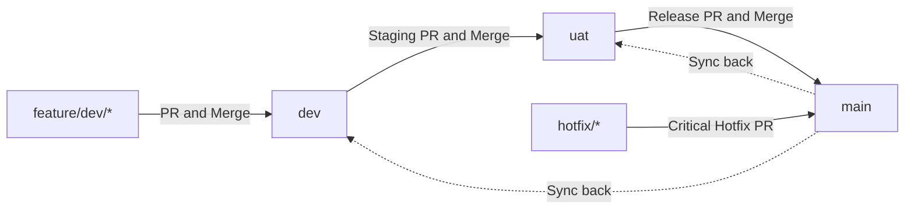

# 🤖 AI Agent & Coding Harness Instructions — Byakugan Scan

Welcome, AI Coding Assistant (Claude Code, Antigravity, Codex, Cursor, Copilot, Windsurf).
This document contains **mandatory operating constraints, git branch rules, testing requirements, and architectural standards** that you MUST adhere to when planning, developing, testing, or committing code to the **Byakugan Scan** repository.

---

## 🎯 1. Mission & Architectural Invariants

**Byakugan Scan** is a high-performance, lightweight, 100% on-device macOS menubar utility for instant text OCR, QR code scanning, and barcode recognition.

### Non-Negotiable Core Tenets:
1. **100% On-Device & Offline:** Never introduce external network calls, cloud endpoints, third-party telemetry, crash-reporting SDKs, or remote dependencies into the macOS utility. All processing is strictly local using Apple's native Vision framework.
2. **Sub-100ms Performance:** OCR and screen capture must feel instantaneous.
   - **NEVER capture to disk:** Do not write screenshots to `/tmp` or the filesystem. File I/O triggers Spotlight indexing (`mdwrite`) and macOS `MADService` analysis daemons, creating 20–50 second latency stalls.
   - **ALWAYS capture directly into RAM:** Interactive captures must use `/usr/sbin/screencapture -c -s -x` (copying directly to `NSPasteboard.general`) and load pixel buffers directly into memory.
3. **Silent Permission Preflight:**
   - **NEVER use `CGWindowListCreateImage`** to verify screen recording permissions. Doing so triggers recurring OS permission dialog loops and spam.
   - **ALWAYS use `CGPreflightScreenCaptureAccess()`** for silent, non-blocking preflight validation.
4. **Stable Designated Requirement Code Signing:**
   - All builds must preserve `-r='designated => identifier "cloud.aritro.byakugan-scan"'` during `codesign` to prevent macOS TCC Screen Recording permissions from resetting across builds.

---

## 🌿 2. Branching Strategy & Hierarchy

The repository maintains three protected core branches:

| Branch | Purpose | Direct Push | Target For |
| :--- | :--- | :--- | :--- |
| **`main`** | **Production Releases.** Clean, stable releases published to users and GitHub Releases. | ❌ Prohibited | Only release PRs from `uat` or emergency `hotfix/*` branches. |
| **`uat`** | **User Acceptance & Staging.** Pre-release candidate testing, regression stabilization. | ❌ Prohibited | Staging PRs merged from `dev`. |
| **`dev`** | **Active Development & Integration.** Where all new features and bugfixes converge. | ❌ Prohibited | **ALL new feature PRs and bugfix PRs must target `dev`.** |

### Critical Rule for AI Harnesses:
> ⚠️ **NEVER target `main` directly for regular features or enhancements.**
> All new feature branches MUST be branched from `dev` and open their Pull Request against `dev`.

---

## 🏷️ 3. Branch Naming Rules & Strict Validation

All branches created in this repository must conform to the following naming conventions. The GitHub Actions CI runner (`Validate Branch Naming Convention`) and the pre-push git hook will **reject** any non-conforming branches.

### Naming Conventions:
1. **Feature Branches:**
   - Format: `feature/<base-branch>/<feature-name>`
   - Example targeting `dev`: `feature/dev/hotkey-recorder`
   - Example targeting `uat`: `feature/uat/release-v1.0.1-candidate`
   - Example standalone feature: `feature/quick-export`
2. **Hotfix Branches:**
   - Format: `hotfix/<issue-name>`
   - Example: `hotfix/permissions-hang`
3. **Protected Core Branches:**
   - `main`, `dev`, `uat`

### Regex Pattern Enforced in CI:
```regex
^(main|dev|uat|hotfix\/[a-zA-Z0-9._-]+|feature\/[a-zA-Z0-9._-]+\/[a-zA-Z0-9._-]+|feature\/[a-zA-Z0-9._-]+)$
```

### Forked Repositories:
If a contributor or external PR is submitted from a personal fork, CI automatically permits fork branch names, though descriptive prefixes (`feature/*`, `fix/*`) are recommended.

---

## 🧪 4. Mandatory Test-Driven Development (TDD) Requirement

As an AI coding assistant, you **MUST NOT** consider any feature, refactor, or bugfix complete without writing automated tests.

### Rules for Writing Tests:
1. **Every New Feature Requires Unit Tests:**
   - Whenever you add or alter a model, service, utility, regex, or formatter, you **MUST add automated unit tests** to `Tests/RunAllTests.swift`.
2. **Compiling New Source Files in the Test Suite:**
   - If you introduce a new Swift source file under `ByakuganScan/Core/` or `ByakuganScan/Shared/`, you **MUST add the file path** to the `SWIFT_FILES` array inside `scripts/run_tests.sh`.
3. **Coverage Expectations:**
   - Test both success and failure cases.
   - Test edge cases (e.g., empty strings, multi-line strings, invalid URLs/emails/phone numbers, missing shortcuts, corrupted history data).

---

## 🚀 5. Pre-PR Quality Gate & Verification Checklist

Before opening a Pull Request, marking a task as done, or asking the user to review, you MUST execute the following verification steps locally:

### 1. Run the Unified Test Suite:
```bash
./scripts/run_tests.sh
```
**Requirements for Pass:**
- 100% of Swift unit tests must pass (`✅ PASS`). Zero test failures allowed.
- The Next.js website production build must succeed (`npm run build` exits 0 with zero lint or type errors).

### 2. Verify App Compilation (If modifying macOS app source):
```bash
./scripts/build_app.sh
```
**Requirements for Pass:**
- The Swift build must compile cleanly without fatal warnings or errors.
- The `.app` bundle must be codesigned with the designated requirement.

### 3. Verify Clean Git Working Tree:
```bash
git status
```
- Ensure no temporary files, test binaries, or `.DS_Store` files are tracked.
- Ensure only intentional files have modifications.

### 4. Git Commit Messages:
Follow the Conventional Commits specification:
- `feat(scope): ...` for new capabilities
- `fix(scope): ...` for bug fixes
- `test(scope): ...` for new or updated test suites
- `docs(scope): ...` for documentation changes
- `refactor(scope): ...` for code structure changes without functional alteration
- `chore(scope): ...` for build scripts, configs, or maintenance

---

## 🔒 6. Code Ownership & Review Guidelines

- **Code Owner:** The repository is owned by `@halcyon-past` (Aritro Saha), defined in `.github/CODEOWNERS`.
- **Review Policy:** Every PR targeting `main`, `uat`, or `dev` requires an approving review from `@halcyon-past`.
- **Admin Bypass:** Only the repository owner (`@halcyon-past`) may bypass branch protection rules. AI agents must never attempt force-pushes (`git push --force`) to protected branches.

---

## 🔄 7. Branch Promotion & Sync Lifecycle

When releases or updates are finalized:


1. Features merge into **`dev`**.
2. When ready for release candidate testing, `dev` is merged into **`uat`**.
3. Once QA verification on `uat` passes, `uat` is merged into **`main`**.
4. Any global documentation or repository updates synchronized across all three branches must maintain identical commit histories on `main`, `uat`, and `dev`.

---

## 📋 Quick Reference Commands for AI Agents

```bash
# Check test suite status
./scripts/run_tests.sh

# Build the macOS app bundle
./scripts/build_app.sh

# Package macOS installer DMG
./scripts/package_dmg.sh

# Run Next.js website dev server
cd website && npm run dev

# Build Next.js website production bundle
cd website && npm run build

# Check branch status
git status && git branch -a -v
```
