<div align="center">
  <picture>
    <source media="(prefers-color-scheme: dark)" srcset="Assets/Icons/AS_icon_darkmode_256x256.png" />
    <source media="(prefers-color-scheme: light)" srcset="Assets/Icons/AS_icon_lightmode_256x256.png" />
    
  </picture>

  <h1>Byakugan Scan</h1>

  <p>
    <strong>Instant, in-memory screen OCR, QR code, and barcode recognition for macOS.</strong><br />
    Zero temporary files. Zero network calls. Under 50ms on Apple Silicon.
  </p>

  <p>
    <a href="https://github.com/halcyon-past/byakugan-scan/releases/latest"></a>
    <a href="https://github.com/halcyon-past/byakugan-scan/actions/workflows/ci.yml"></a>
    
    
    <a href="LICENSE"></a>
  </p>

  <p>
    <a href="https://byakugan-scan.aritro.cloud">Website</a> ·
    <a href="https://github.com/halcyon-past/byakugan-scan/releases/latest/download/ByakuganScan.dmg">Download DMG</a> ·
    <a href="https://byakugan-scan.aritro.cloud/support">Support &amp; FAQ</a> ·
    <a href="CHANGELOG.md">Changelog</a>
  </p>
</div>

---

## Why This Exists

Most screen OCR utilities on macOS work by spawning a screenshot to `/tmp`, reading the `.png` file back from disk, and deleting it afterward. On modern macOS, writing an image file to disk immediately wakes up Spotlight (`mdwrite`) and `MADService` media analysis daemons, which can stall the capture pipeline for several seconds.

**Byakugan Scan** skips the filesystem entirely:

1. A custom 60/120Hz AppKit overlay (`SelectionOverlayController`) lets you drag a selection rectangle across any display.
2. The selected region is captured straight into `NSPasteboard` memory (`/usr/sbin/screencapture -c -x -R<x,y,w,h>`) and converted into a `CGImage` buffer in RAM.
3. Apple's on-device Vision framework (`VNRecognizeTextRequest` / `VNDetectBarcodesRequest`) runs directly on the Neural Engine and copies the result to your clipboard.
4. Screen Recording permission is checked silently via `CGPreflightScreenCaptureAccess()`—never `CGWindowListCreateImage`—so macOS never traps you in recurring permission prompt loops.

The entire app has no network client entitlements, no analytics SDKs, and no external Swift package dependencies.

## Install

### Homebrew (Recommended)

```bash
brew install --cask halcyon-past/tap/byakugan-scan
```

To upgrade later:

```bash
brew upgrade --cask byakugan-scan
```

### Direct Download

Download [`ByakuganScan.dmg`](https://github.com/halcyon-past/byakugan-scan/releases/latest/download/ByakuganScan.dmg) from the [latest release](https://github.com/halcyon-past/byakugan-scan/releases/latest), drag **Byakugan Scan.app** to `/Applications`, and grant **Screen Recording** access in **System Settings → Privacy & Security → Screen Recording**.

## Usage & Shortcuts

Byakugan Scan runs in the macOS menu bar. Trigger a scan from anywhere using global hotkeys (all customizable in **Settings (`⌘,`) → Shortcuts**):

| Mode | Default Shortcut | What it does |
| :--- | :--- | :--- |
| **Capture Text (OCR)** | `⌘` `⇧` `2` | Extracts unselectable text from videos, slides, PDFs, or images into your clipboard |
| **Scan QR Code** | `⌘` `⇧` `3` | Decodes QR and MicroQR payloads on screen (with one-click `Open` / `Mail` / `Call` actions) |
| **Scan Barcode** | `⌘` `⇧` `4` | Decodes EAN-8/13, UPC-E, Code 128/39/93, PDF417, Aztec, Data Matrix, and ITF-14 |
| **Cancel Selection** | `Esc` | Dismisses the selection overlay without touching your clipboard |

### Deep Links & Automation (`byakugan://`)

You can trigger Byakugan Scan from Raycast, Alfred, BetterTouchTool, Stream Deck, or macOS Shortcuts without simulating keystrokes:

```bash
open "byakugan://scan?mode=text"
open "byakugan://scan?mode=qr"
open "byakugan://scan?mode=barcode"
open "byakugan://scan?mode=last"      # Re-copies the most recent scan result
open "byakugan://settings"            # Opens the Settings window
open "byakugan://history"             # Opens the menu bar popover to History
```

## What's Inside

- **Custom Reticle & Theme Accents** — Customize the interactive selection box and UI tint (`Byakugan Violet`, `Tenseigan Cyan`, `Sharingan Crimson`, `Sage Emerald`, or `Nine-Tails Amber`) and backdrop dimming opacity (`10%–80%`), with a live preview in Settings.
- **Floating HUD Pill** — Frosted-glass toast notification showing word/character counts and contextual actions (`Open URL`, `Send Email`, `Call Number`) without cluttering Notification Center.
- **Configurable Audio Feedback** — Choose from *Glass*, *Tink*, *Pop*, *Purr*, *Funk*, or *Submarine* with instant preview in Settings.
- **Table & Grid OCR Detection (Markdown & CSV)** — Automatically clusters columnar layout in captured tables, spreadsheets, or dashboard grids (AWS, Stripe, terminal outputs) and formats them cleanly into aligned GitHub-Flavored Markdown tables (`| Col 1 | Col 2 |`) or RFC 4180 CSV for instant pasting into spreadsheet apps.
- **Smart De-Hyphenation** — Automatically rejoins split words across line boundaries in justified text, PDFs, and academic journals (`super-\ncomputer` → `supercomputer`) while preserving intentional compound words, dashes, subtraction operators, and markdown lists.
- **Multi-Language OCR & Formatting** — Automatic language detection across 13+ primary languages, with toggles to preserve line breaks, join multi-line paragraphs with spaces, or append scans additively to the clipboard.
- **Local Scan History** — Searchable local history stored in `~/Library/Application Support/ByakuganScan/history.json` with category filters (`Text`, `QR`, `Barcode`, `Starred`) and pinning.

## Building from Source

Requires **macOS 14.0+**, **Xcode 15+ / Swift 6**, and [XcodeGen](https://github.com/yonaskolb/XcodeGen) (`brew install xcodegen`).

```bash
git clone https://github.com/halcyon-past/byakugan-scan.git
cd byakugan-scan

# Build and codesign the app bundle
./scripts/build_app.sh
open "build/Byakugan Scan.app"

# Run the Swift unit test suite & Next.js website build check
./scripts/run_tests.sh
```

> **Note on TCC permissions when building locally:** [`scripts/build_app.sh`](scripts/build_app.sh) signs the bundle with a stable designated requirement (`designated => identifier "cloud.aritro.byakugan-scan"`) so rebuilding locally does not invalidate your macOS Screen Recording permission entry. If macOS ever caches a stale signature, reset it with:
> ```bash
> tccutil reset ScreenCapture cloud.aritro.byakugan-scan
> ```

## Repository Layout

```text
ByakuganScan/
├── App/                  # App entry point, menu bar NSStatusItem, hotkey lifecycle
├── Core/
│   ├── Models/           # ScanResult, AppSettings, ThemeAccent, SoundEffect, FeedbackStyle, TableFormat
│   ├── Services/         # OCRService, TableFormatter, BarcodeService, ScreenCaptureService, HotkeyService,
│   │                     # ClipboardService, HistoryService, UpdateService, URLRouteService
│   └── Extensions/       # String formatting/regex helpers & NSImage utilities
├── Features/
│   ├── Home/             # Dashboard window
│   ├── Settings/         # 6-tab Settings window (General, Shortcuts, OCR, Clipboard, Appearance, About)
│   └── Legal/            # In-app Privacy Policy & Terms of Service views
└── Shared/
    ├── Components/       # SelectionOverlayController, FloatingHUDController, MenuBarPopoverView
    └── Constants/        # AppConstants
Tests/                    # Zero-dependency Swift test runner (RunAllTests.swift)
website/                  # Next.js 15 site for byakugan-scan.aritro.cloud
Casks/                    # Homebrew Cask definition synced to halcyon-past/homebrew-tap
scripts/                  # Build, DMG packaging, test runner, and release automation scripts
```

## Contributing

Pull requests should target the `dev` branch using the branch naming convention `feature/dev/<short-name>` or `hotfix/<short-name>`. Before opening a PR, make sure `./scripts/run_tests.sh` passes cleanly. See [CONTRIBUTING.md](CONTRIBUTING.md) for details.

## License

MIT © [Aritro Saha](https://aritro.cloud)